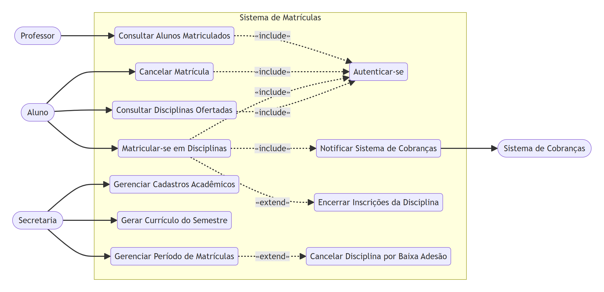

# Sistema de Matrículas — Laboratório 2

Projeto da disciplina **Projeto de Software** (Engenharia de Software — PUC Minas),
Laboratório 2, Segundo Semestre/2026.

> Entrega atual: **Lab02S01** (Modelo de Análise — Diagrama de Caso de Uso e Histórias de Usuário).

## Sobre o sistema

Sistema de matrículas para uma universidade. A secretaria mantém o currículo de cada
semestre e as informações sobre cursos, disciplinas, professores e alunos. Alunos se
matriculam em disciplinas dentro de períodos definidos de matrícula; professores consultam
quem está matriculado em suas disciplinas.

### Regras de negócio principais

- Um **curso** tem nome, número de créditos e é composto por várias disciplinas.
- Um aluno se matricula em até **4 disciplinas obrigatórias** (1ª opção) e **2 disciplinas
  optativas** (alternativas) por semestre.
- Matrículas só podem ser feitas ou canceladas durante o **período de matrículas**.
- Uma disciplina só fica **ativa** no semestre seguinte se tiver **pelo menos 3 alunos**
  inscritos ao final do período de matrículas — caso contrário, é **cancelada**.
- Uma disciplina tem no máximo **60 alunos**; ao atingir esse limite, as inscrições para
  ela são **encerradas** automaticamente.
- Ao se matricular, o aluno gera uma notificação para o **sistema de cobranças**, para ser
  cobrado pelas disciplinas do semestre.
- Todos os usuários (aluno, professor, secretaria) autenticam-se com login e senha.

## Atores

| Ator                                         | Descrição                                                                                                        |
| -------------------------------------------- | ---------------------------------------------------------------------------------------------------------------- |
| **Aluno**                                    | Consulta disciplinas ofertadas, matricula-se e cancela matrículas.                                               |
| **Professor**                                | Consulta os alunos matriculados nas disciplinas que leciona.                                                     |
| **Secretaria**                               | Mantém cursos, disciplinas, professores e alunos; define o período de matrículas e gera o currículo do semestre. |
| **Sistema de Cobranças** _(ator secundário)_ | Sistema externo notificado a cada matrícula, para gerar a cobrança do aluno.                                     |

## Diagrama de Caso de Uso

_Notação: elipses são casos de uso, agrupados dentro do sistema; retângulos arredondados são
atores. Setas sólidas são associações ator↔caso de uso; setas tracejadas são relações
`«include»`/`«extend»` entre casos de uso._

**Observações sobre o diagrama:**

- **Gerenciar Cadastros Acadêmicos** agrega o CRUD de cursos, disciplinas, professores e
  alunos feito pela secretaria — detalhado como histórias de usuário individuais abaixo,
  para não poluir o diagrama com um caso de uso por entidade.
- Os 3 casos de uso da Secretaria também pressupõem `«include» Autenticar-se`, omitido no
  diagrama para reduzir cruzamento de linhas (mantido explícito apenas para Aluno e
  Professor).

**Para editar este diagrama:** o fonte é texto puro em
[docs/diagrama-caso-de-uso.mmd](docs/diagrama-caso-de-uso.mmd) (sintaxe
[Mermaid](https://mermaid.js.org/)). Duas formas de editar:

1. Abra [mermaid.live](https://mermaid.live/), cole o conteúdo do `.mmd`, edite visualmente
   e exporte o PNG por cima de `docs/diagrama-caso-de-uso.png`.
2. Edite o texto do `.mmd` diretamente (é só uma lista de nós e setas) e peça para renderizar
   a imagem novamente.

## Histórias de Usuário

### Aluno

1. Como aluno, quero me autenticar no sistema com login e senha, para acessar minhas
   funcionalidades de matrícula.
2. Como aluno, quero consultar as disciplinas ofertadas no semestre, para escolher em quais
   me matricular.
3. Como aluno, quero me matricular em até 4 disciplinas obrigatórias e 2 optativas, para
   montar minha grade do semestre.
   - A matrícula só é aceita se a disciplina ainda tiver vagas (máximo de 60 alunos).
   - Ao me matricular, o sistema de cobranças deve ser notificado automaticamente.
4. Como aluno, quero cancelar uma matrícula feita anteriormente, durante o período de
   matrículas, para ajustar minha grade se necessário.

### Professor

5. Como professor, quero me autenticar no sistema, para acessar minhas turmas.
6. Como professor, quero consultar a lista de alunos matriculados em cada disciplina que
   leciono, para saber quem são meus alunos no semestre.

### Secretaria

7. Como secretaria, quero me autenticar no sistema, para gerenciar as informações
   acadêmicas.
8. Como secretaria, quero cadastrar e manter os cursos (nome e número de créditos), para
   estruturar a oferta acadêmica.
9. Como secretaria, quero cadastrar e manter as disciplinas de cada curso, para compor o
   currículo.
10. Como secretaria, quero cadastrar professores e associá-los às disciplinas, para
    viabilizar as turmas.
11. Como secretaria, quero cadastrar os alunos da universidade, para que eles possam se
    matricular.
12. Como secretaria, quero gerar o currículo (grade de disciplinas ofertadas) de cada
    semestre, para abrir a oferta às matrículas.
13. Como secretaria, quero definir o período de matrículas (abertura e encerramento), para
    controlar a janela em que alunos podem se matricular ou cancelar.
14. Como secretaria, quero que, ao encerrar o período de matrículas, o sistema cancele
    automaticamente as disciplinas com menos de 3 alunos inscritos, para não manter turmas
    inviáveis.
15. Como secretaria, quero que o sistema encerre automaticamente as inscrições de uma
    disciplina ao atingir 60 alunos matriculados, para respeitar o limite de vagas.

### Sistema de Cobranças _(ator secundário)_

16. Como sistema de cobranças, quero ser notificado sempre que um aluno se matricular em
    disciplinas, para gerar a cobrança correspondente ao semestre.
