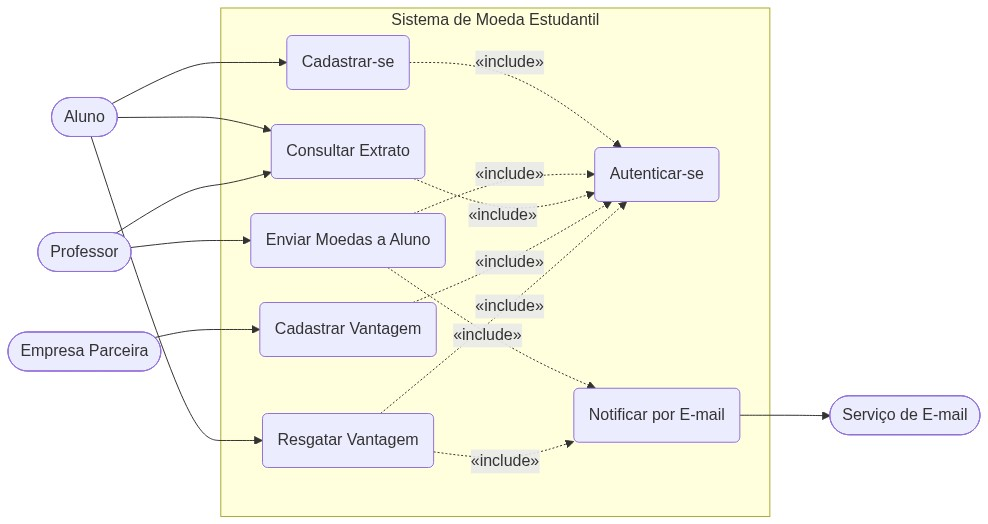
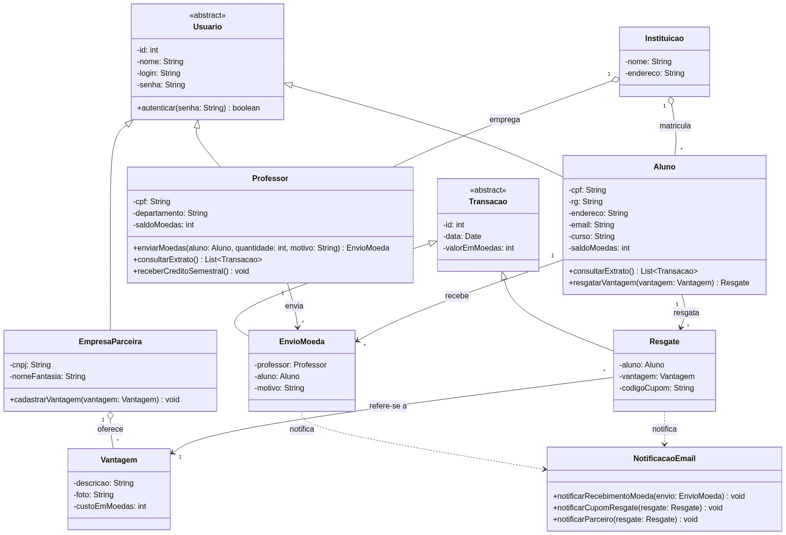
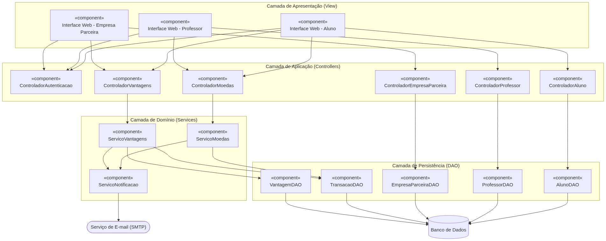
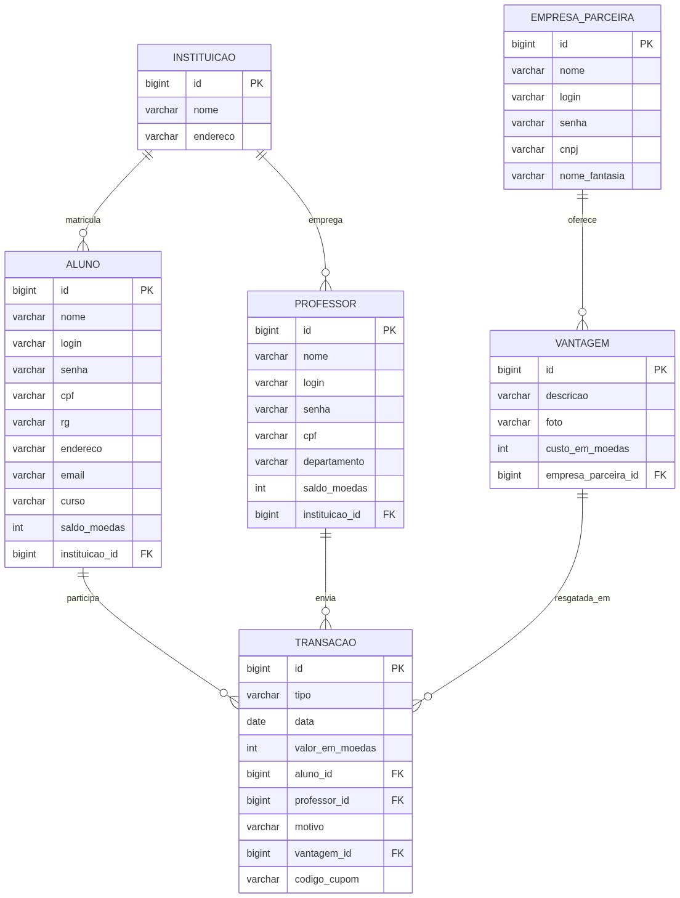

# Sistema de Moeda Estudantil — Laboratório 3

Projeto da disciplina **Projeto de Software** (Engenharia de Software — PUC Minas),
Laboratório 3, Segundo Semestre/2026.

> Entrega atual: **Lab03S02** (Modelo ER, estratégia de acesso ao banco de dados e CRUDs
> iniciais de Aluno e Empresa Parceira).

## Sobre o sistema

Sistema para estimular o reconhecimento do mérito estudantil através de uma moeda
virtual. Professores distribuem moedas aos alunos como reconhecimento, e os alunos trocam
essas moedas por vantagens (descontos, produtos) oferecidas por empresas parceiras.

### Regras de negócio principais

- Alunos se cadastram informando nome, e-mail, CPF, RG, endereço, instituição de ensino
  (pré-cadastrada) e curso.
- Professores e instituições já vêm **pré-cadastrados** no sistema (a instituição envia a
  lista de professores no momento da parceria) — esse processo de carga inicial é tratado
  como dado semente, fora do escopo dos casos de uso modelados aqui.
- A cada semestre, cada professor recebe **1.000 moedas**, que se **acumulam** caso não
  sejam todas distribuídas no semestre anterior.
- Ao enviar moedas a um aluno, o professor deve ter saldo suficiente e informar um
  **motivo obrigatório** (mensagem aberta).
- Ao receber moedas, o aluno é **notificado por e-mail**.
- Alunos e professores podem consultar o **extrato** da conta (saldo e transações: envio
  para o professor; recebimento ou troca para o aluno).
- Para trocar moedas, o aluno escolhe uma **vantagem** cadastrada por uma empresa parceira
  (desconto, produto, etc.).
- Empresas parceiras se cadastram e cadastram suas vantagens, cada uma com descrição,
  foto e custo em moedas.
- Ao resgatar uma vantagem, o valor é descontado do saldo do aluno, e um **e-mail de
  cupom** (com código gerado pelo sistema) é enviado tanto ao aluno quanto à empresa
  parceira, para conferência na troca presencial.
- Alunos, professores e empresas parceiras autenticam-se com login e senha.

## Atores

| Ator                                 | Descrição                                                                                     |
| ------------------------------------- | ---------------------------------------------------------------------------------------------- |
| **Aluno**                             | Cadastra-se, consulta extrato e resgata vantagens oferecidas por empresas parceiras.           |
| **Professor**                         | Envia moedas aos alunos como reconhecimento e consulta seu extrato.                            |
| **Empresa Parceira**                  | Cadastra-se e cadastra as vantagens que oferece em troca de moedas.                            |
| **Serviço de E-mail** _(ator secundário)_ | Sistema externo acionado para notificar alunos e parceiros (recebimento de moeda, cupons). |

## Diagrama de Caso de Uso



_Notação: elipses são casos de uso, agrupados dentro do sistema; retângulos arredondados são
atores. Setas sólidas são associações ator↔caso de uso; setas tracejadas são relações
`«include»` entre casos de uso._

**Observações sobre o diagrama:**

- O pré-cadastro de instituições e professores não aparece como caso de uso — é dado
  semente do sistema, não uma funcionalidade acionada por um ator.
- **Enviar Moedas a Aluno** e **Resgatar Vantagem** incluem **Notificar por E-mail**, que
  por sua vez aciona o ator secundário Serviço de E-mail.
- Todos os casos de uso de Aluno, Professor e Empresa Parceira pressupõem
  `«include» Autenticar-se`.

**Para editar este diagrama:** o fonte é texto puro em
[docs/diagrama-caso-de-uso.mmd](docs/diagrama-caso-de-uso.mmd) (sintaxe
[Mermaid](https://mermaid.js.org/)). Duas formas de editar:

1. Abra [mermaid.live](https://mermaid.live/), cole o conteúdo do `.mmd`, edite visualmente
   e exporte o PNG por cima de `docs/diagrama-caso-de-uso.png`.
2. Edite o texto do `.mmd` diretamente (é só uma lista de nós e setas) e peça para renderizar
   a imagem novamente.

## Histórias de Usuário

### Aluno

1. Como aluno, quero me cadastrar informando meus dados pessoais e selecionando minha
   instituição de ensino, para ingressar no sistema de mérito.
2. Como aluno, quero me autenticar no sistema com login e senha, para acessar minhas
   funcionalidades.
3. Como aluno, quero consultar o extrato da minha conta, para ver meu saldo de moedas e
   o histórico de recebimentos e trocas.
4. Como aluno, quero resgatar uma vantagem cadastrada por uma empresa parceira, para trocar
   minhas moedas por produtos ou descontos.
   - O valor da vantagem é descontado do meu saldo.
   - Recebo um e-mail com um cupom (código gerado pelo sistema) para usar na troca
     presencial.

### Professor

5. Como professor, quero me autenticar no sistema, para acessar minhas funcionalidades.
6. Como professor, quero enviar moedas a um aluno informando o motivo do reconhecimento,
   para premiar bom comportamento ou participação em aula.
   - Preciso ter saldo suficiente para o envio.
   - O motivo é uma mensagem aberta e obrigatória.
7. Como professor, quero que meu saldo seja reabastecido automaticamente a cada semestre
   com 1.000 moedas, acumulando o que não usei, para continuar reconhecendo meus alunos.
8. Como professor, quero consultar o extrato da minha conta, para ver meu saldo e o
   histórico de moedas enviadas.

### Empresa Parceira

9. Como empresa parceira, quero me cadastrar no sistema, para oferecer vantagens aos
   alunos.
10. Como empresa parceira, quero cadastrar vantagens com descrição, foto e custo em
    moedas, para que os alunos possam resgatá-las.
11. Como empresa parceira, quero receber um e-mail com o código do cupom quando um aluno
    resgatar uma vantagem, para conferir a troca presencial.

### Serviço de E-mail _(ator secundário)_

12. Como serviço de e-mail, quero ser acionado sempre que um aluno receber moedas ou
    resgatar uma vantagem, para notificar os envolvidos (aluno e, quando aplicável, a
    empresa parceira).

## Diagrama de Classes



**Observações sobre o diagrama:**

- `Usuario` é uma classe abstrata com login/senha e autenticação; `Aluno`, `Professor` e
  `EmpresaParceira` herdam dela, já que os três atores autenticam-se do mesmo jeito.
- `Transacao` é uma classe abstrata que generaliza `EnvioMoeda` (professor → aluno) e
  `Resgate` (aluno → vantagem), refletindo o extrato único mencionado no enunciado
  ("transações que realizou").
- `NotificacaoEmail` é a classe de integração com o serviço externo de e-mail (ator
  secundário do caso de uso), acionada por `EnvioMoeda` e `Resgate`.
- `Instituicao` aparece apenas como dado associado a `Aluno`/`Professor`, sem casos de uso
  de cadastro próprios (ver observação no diagrama de casos de uso).
- Os atributos e assinaturas de métodos aqui modelados são os que serão implementados como
  stubs (métodos vazios) no projeto Java desta sprint.

**Para editar este diagrama:** mesmo fluxo do diagrama de caso de uso — o fonte é
[docs/diagrama-classes.mmd](docs/diagrama-classes.mmd) (sintaxe
[Mermaid](https://mermaid.js.org/)). Edite o `.mmd` e cole em [mermaid.live](https://mermaid.live/)
para visualizar/exportar o PNG novamente.

## Diagrama de Componentes



**Observações sobre o diagrama:**

- A arquitetura segue o padrão **MVC** exigido a partir da Sprint 02: Camada de
  Apresentação (View), Camada de Aplicação (Controllers), Camada de Domínio (Services) e
  Camada de Persistência (DAO).
- `ServicoMoedas` e `ServicoVantagens` concentram as regras de negócio (saldo, crédito
  semestral, desconto ao resgatar) e delegam a persistência aos componentes DAO.
- `ServicoNotificacao` isola a integração com o Serviço de E-mail externo, reutilizado
  tanto pelo fluxo de envio de moedas quanto pelo de resgate de vantagens.
- Os componentes DAO encapsulam o acesso ao Banco de Dados, antecipando a estratégia de
  persistência (ORM/DAO) que será detalhada na Sprint 02.

**Para editar este diagrama:** mesmo fluxo dos diagramas anteriores — o fonte é
[docs/diagrama-componentes.mmd](docs/diagrama-componentes.mmd) (sintaxe
[Mermaid](https://mermaid.js.org/)). Edite o `.mmd` e cole em [mermaid.live](https://mermaid.live/)
para visualizar/exportar o PNG novamente.

## Modelo ER



**Observações sobre o diagrama:**

- `Aluno`, `Professor` e `EmpresaParceira` viram tabelas independentes (sem tabela
  `USUARIO` compartilhada) — cada uma guarda suas próprias colunas de login/senha/nome,
  para simplificar o mapeamento objeto-relacional nesta sprint.
- `TRANSACAO` concentra envio de moedas e resgate de vantagem numa única tabela, com a
  coluna `tipo` distinguindo os dois casos (`ENVIO`/`RESGATE`) — reflete a herança
  `Transacao`→`EnvioMoeda`/`Resgate` do diagrama de classes, mapeada como herança de
  tabela única (`SINGLE_TABLE`) no JPA.
- `professor_id`, `motivo`, `vantagem_id` e `codigo_cupom` em `TRANSACAO` são nulos
  dependendo do tipo (um envio não tem vantagem/cupom; um resgate não tem professor).

**Para editar este diagrama:** mesmo fluxo dos demais — o fonte é
[docs/modelo-er.mmd](docs/modelo-er.mmd) (sintaxe [Mermaid](https://mermaid.js.org/)).
Edite o `.mmd` e cole em [mermaid.live](https://mermaid.live/) para visualizar/exportar o
PNG novamente.

## Estratégia de Persistência

Projeto Java com **Spring Boot** em [app/](app/), usando:

- **ORM**: Spring Data JPA + Hibernate — as entidades (`Aluno`, `Professor`,
  `EmpresaParceira`, `Instituicao`, `Vantagem`, `Transacao`/`EnvioMoeda`/`Resgate`) ficam em
  [app/src/main/java/br/puc/moedaestudantil/model](app/src/main/java/br/puc/moedaestudantil/model),
  anotadas com `@Entity` e mapeadas para as tabelas do Modelo ER acima.
- **Padrão DAO**: implementado pelas interfaces `Repository` (ex.:
  [AlunoRepository](app/src/main/java/br/puc/moedaestudantil/repository/AlunoRepository.java)),
  que estendem `JpaRepository` — o Spring Data gera a implementação do acesso a dados em
  tempo de execução.
- **Banco de dados**: H2 em arquivo (`app/data/moedaestudantil`), a opção mais simples para
  rodar sem precisar instalar/configurar um servidor de banco separado. O console web do H2
  (`/h2-console`) fica habilitado para inspecionar as tabelas durante a apresentação.
- **Arquitetura MVC**: `Controller` (Spring MVC) → `Service` (regra de negócio) →
  `Repository` (DAO/ORM) → banco; a View é renderizada em **Thymeleaf**, no próprio
  Spring Boot (sem front-end separado nesta sprint).
- Métodos do diagrama de classes que não fazem parte do CRUD desta sprint (`autenticar()`,
  `consultarExtrato()`, `enviarMoedas()`, etc.) estão presentes como **stubs** nas
  entidades, mantendo o alinhamento entre modelo e código.

## CRUDs (versão inicial)

Implementados: **Aluno**, **Empresa Parceira** e **Vantagem** — criar, listar, editar e
excluir, com tela (Thymeleaf) e persistência via back-end. O cadastro de Aluno escolhe a
Instituição numa lista pré-cadastrada (ver Dados de apoio abaixo); o cadastro de Vantagem
escolhe a Empresa Parceira dona dela. As demais entidades do domínio existem como
tabelas/classes JPA (ver Modelo ER), mas ainda sem tela própria.

## Dados de apoio (seed)

O enunciado trata Instituição e Professor como **pré-cadastrados** (a instituição manda a
lista de professores na parceria) — não há caso de uso para o aluno ou qualquer ator
cadastrá-los pelo sistema. Por isso, em vez de tela de CRUD, uma classe
[DataSeeder](app/src/main/java/br/puc/moedaestudantil/config/DataSeeder.java)
(`CommandLineRunner`) popula 2 instituições e 2 professores de exemplo na primeira
inicialização do banco (só roda se a tabela de instituições estiver vazia, então não
duplica em restarts seguintes).

## Roteiro das regras de negócio ainda pendentes

A Sprint 2 cobre o checklist do enunciado (Modelo ER, persistência, CRUDs iniciais), mas
o domínio completo do Sistema de Moeda Estudantil tem mais regras de negócio a implementar
até a entrega final (Sprint 03). Planejado em fases, para não misturar mudanças grandes:

1. ~~Dados de apoio~~ — seed de Instituição/Professor + CRUD de Vantagem. ✅
2. **Autenticação** — login por sessão (Aluno/Professor/EmpresaParceira), senha com hash
   BCrypt, proteção das rotas que exigem login.
3. **Fluxo de moedas** — Professor envia moedas a Aluno (valida saldo, motivo
   obrigatório), crédito semestral de 1.000 moedas, extrato (Aluno e Professor).
4. **Resgate de vantagem** — Aluno troca moedas por Vantagem, desconta saldo, gera código
   de cupom.
5. **Notificações por e-mail (simuladas via log)** — ao receber moeda e ao resgatar
   vantagem (aluno + empresa parceira).

## Como executar

Pré-requisito: JDK 17+ instalado (`JAVA_HOME` configurado). O Maven é baixado
automaticamente pelo Maven Wrapper, não precisa instalar nada além do JDK.

```powershell
cd lab03/app
.\mvnw.cmd spring-boot:run
```

Depois, acesse:

- http://localhost:8080/alunos — CRUD de Alunos
- http://localhost:8080/empresas-parceiras — CRUD de Empresas Parceiras
- http://localhost:8080/vantagens — CRUD de Vantagens
- http://localhost:8080/h2-console — console do banco H2 (JDBC URL:
  `jdbc:h2:file:./data/moedaestudantil`, usuário `sa`, senha em branco)
